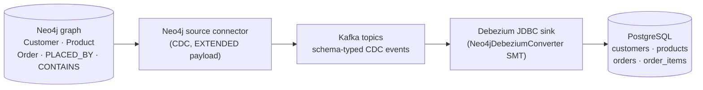

# Debezium Neo4j (Graph → Relational)

This example streams a **Neo4j** property graph into a relational **PostgreSQL** schema using Change
Data Capture. It is the reverse of the [relational → graph example](../debezium-relational-to-neo4j): together the
two keep a graph database and a relational database in sync in either direction.

The pipeline is:

```
Neo4j -> Neo4j source connector (CDC) -> Kafka -> [Neo4jDebeziumConverter SMT] -> Debezium JDBC sink -> PostgreSQL
```

1. The **official Neo4j Kafka source connector** captures Neo4j CDC change events.
2. The **[`Neo4jDebeziumConverter` SMT](https://github.com/debezium/debezium/blob/main/documentation/modules/ROOT/pages/transformations/neo4j-debezium-converter.adoc)**
   (running on the sink connector) converts each self-describing Neo4j CDC event into the Debezium
   change-event envelope, deriving the target table, primary key, and columns from the event.
3. The **Debezium JDBC sink connector** writes the envelopes into PostgreSQL, auto-creating the
   tables.

The graph maps to this relational schema:

```
(:Customer)                                    -> customers(id, first_name, last_name, email)
(:Product)                                     -> products(id, name, price)
(:Order)                                       -> orders(id, total, status, …)
(:Order)-[:PLACED_BY]->(:Customer)             -> orders.customer_id foreign key
(:Order)-[:CONTAINS {quantity}]->(:Product)    -> order_items(order_id, product_id, quantity) join table
```

## Contents

* [Architecture](#architecture)
* [Prerequisites](#prerequisites)
* [Running the example](#running-the-example)
* [Exploring the relational data](#exploring-the-relational-data)
* [Cleanup](#cleanup)
* [References](#references)

## Architecture




## Prerequisites

* Docker and Docker Compose
* Ports free on localhost: `8083` (Connect), `7474`/`7687` (Neo4j), `5432` (Postgres), and `9092`
  (Kafka)

All commands below run from this directory and inherit `DEBEZIUM_VERSION` and `POSTGRES_VERSION`
from the repository's root [`.env`](../.env).

> **Note:** Neo4j Change Data Capture is a Neo4j **Enterprise** feature, so this example uses the
> `neo4j:5-enterprise` image. Starting it accepts the Neo4j evaluation license agreement
> (`NEO4J_ACCEPT_LICENSE_AGREEMENT=yes`) for development/evaluation use.

## Running the example

Start everything (the `--build` adds the Neo4j connector to the Connect image). The `neo4j-init`
helper container enables CDC on the `neo4j` database and seeds the demo graph, then exits:

```shell
docker-compose --env-file ../.env up --build
```

In a second terminal, register the Neo4j source connector and the Debezium JDBC sink:

```shell
curl -i -X POST -H "Accept:application/json" -H "Content-Type:application/json" \
  http://localhost:8083/connectors/ -d @register-neo4j-source.json
curl -i -X POST -H "Accept:application/json" -H "Content-Type:application/json" \
  http://localhost:8083/connectors/ -d @register-jdbc-sink.json
```

## Exploring the relational data

Query the tables the JDBC sink auto-created in PostgreSQL:

```shell
docker-compose --env-file ../.env exec postgres \
  psql -U postgres -d postgres -c "SELECT id, first_name, last_name, email FROM customers ORDER BY id;"
docker-compose --env-file ../.env exec postgres \
  psql -U postgres -d postgres -c "SELECT id, total, status, customer_id FROM orders ORDER BY id;"
docker-compose --env-file ../.env exec postgres \
  psql -U postgres -d postgres -c "SELECT order_id, product_id, quantity FROM order_items ORDER BY order_id;"
```

Make a change in Neo4j and watch it flow into PostgreSQL:

```shell
docker-compose --env-file ../.env exec neo4j \
  cypher-shell -u neo4j -p password \
  "CREATE (:Customer {id: 1005, firstName: 'John', lastName: 'Doe', email: 'john.doe@example.com'});"
```

A few seconds later the new row appears in `customers`:

```shell
docker-compose --env-file ../.env exec postgres \
  psql -U postgres -d postgres -c "SELECT first_name, last_name FROM customers WHERE id = 1005;"
```

## Cleanup

```shell
docker-compose --env-file ../.env down -v
```

## References

* [`Neo4jDebeziumConverter` SMT documentation](https://github.com/debezium/debezium/blob/main/documentation/modules/ROOT/pages/transformations/neo4j-debezium-converter.adoc) — the graph → relational SMT used by this example.
