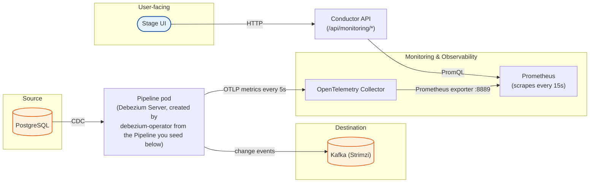

Using Debezium Platform with built-in Monitoring
===

This example walks you through running the Debezium Management Platform with **monitoring enabled**.

It builds directly on [`../postgresql-kafka-example`](../postgresql-kafka-example), which walks through the UI
in detail (Connections, Sources, Destinations, Pipeline) and explains every field. Read that one first. Here we
reuse the same PostgreSQL → Kafka pipeline and focus on wiring monitoring into the platform,
reading the panels, and making them move.

Every step is backed by a script in this directory, so you can read along and run them, or open them to see
exactly what they do. All scripts source [`env.sh`](./env.sh) for shared configuration (namespaces, versions,
hostnames) — edit it once and every script picks it up.

How a number gets onto a panel
---



The pipeline pod exports metrics over OTLP, the OpenTelemetry Collector re-exposes them in Prometheus format,
Prometheus scrapes the collector, and the Stage UI asks the Conductor for a panel — which runs a PromQL query
against Prometheus. Every panel you see is the end of that chain.

Prepare the environment
---

**Prerequisites**

- [minikube](https://minikube.sigs.k8s.io/docs/)
- `kubectl`, `helm`
- `curl` and [`jq`](https://jqlang.org/) (used by the seed/verify scripts to talk to the Conductor API)

> **_NOTE:_** This example reuses the same minikube profile name (`debezium`) and `/etc/hosts` entry
> (`platform.debezium.io`) as [`../postgresql-kafka-example`](../postgresql-kafka-example). Run `./clean-up.sh`
> in that example first if you still have it running, or edit `CLUSTER` in [`env.sh`](./env.sh) to use a
> different profile.

`create-environment.sh` provisions a local minikube cluster with an ingress controller and points
`platform.debezium.io` at it via `/etc/hosts`. The monitoring stack is heavier than the base example, so this
cluster is sized up (`--cpus=6 --memory=8192`).

```sh
./create-environment.sh
```

> **_NOTE:_** On macOS, keep the printed `sudo minikube tunnel -p debezium` command running in a separate
> terminal for the rest of this example — the ingress isn't reachable from the host without it.

Install the platform with monitoring
---

### 1. Install the monitoring stack

Monitoring depends on two operators, which must exist before the platform is installed:

- the **OpenTelemetry Operator**, which turns the `OpenTelemetryCollector` resource the platform chart creates
  into a running collector pod,
- **kube-prometheus-stack**, which provides the Prometheus Operator (it consumes `ServiceMonitor` resources)
  and the Prometheus server the Conductor queries.

```sh
./setup-monitoring.sh
```

> **_NOTE:_** The script installs `kube-prometheus-stack` under that exact release name.
> Both `monitoring.prometheus.url` and the `ServiceMonitor` label in the next steps are derived from it.

```sh
$ kubectl get pods -n monitoring

NAME                                                     READY   STATUS    RESTARTS   AGE
prometheus-kube-prometheus-stack-prometheus-0            2/2     Running   0          2m10s
kube-prometheus-stack-operator-6c6d4f8d9-abcde           1/1     Running   0          2m40s
kube-prometheus-stack-kube-state-metrics-7f9d8c6-fghij   1/1     Running   0          2m40s
alertmanager-kube-prometheus-stack-alertmanager-0        2/2     Running   0          2m10s
```

### 2. Install the source database and destination Kafka

Same as the base example: a PostgreSQL instance pre-seeded with the `inventory` schema as the source, and a
Strimzi-managed Kafka cluster as the destination.

```sh
./setup-infra.sh
```

### 3. Deploy the Debezium Platform

Here we install the same `debezium-platform` Helm chart, but
[`values.yaml`](./values.yaml) adds a `monitoring` block on top of the usual `domain`/`database`/`ingress`
settings:

```yaml
monitoring:
  otel:
    enabled: true
    collector:
      image: "ghcr.io/open-telemetry/opentelemetry-collector-releases/opentelemetry-collector-contrib:0.152.0"
  prometheus:
    url: "http://kube-prometheus-stack-prometheus.monitoring.svc.cluster.local:9090"
    serviceMonitor:
      labels:
        release: kube-prometheus-stack
```

<!-- That is the whole file, and every line in it differs from the chart default — anything already matching the
default is left out, so nothing here is decoration. (The base example passes its two settings as `--set` flags
instead. This one uses a file because these settings need the explanatory comments more than they need to fit
on a command line, and because the optional custom-panels layer later on has to be a file regardless.) -->

In short:

- `otel.enabled: true` is what makes the chart create the collector and point new pipelines at it.
- `otel.collector.image` must be a distribution that bundles the **Prometheus exporter** (`contrib`, not the
  operator's default `otelcol-k8s`), or the collector pod crash-loops.
- `prometheus.url` must be **fully qualified**, because Prometheus and the Conductor are in different namespaces.
- `serviceMonitor.labels.release` must match the Prometheus Helm release name.
 <!-- This is the single most common reason monitoring "looks installed" but every panel stays empty. -->

```sh
./setup-platform.sh
```

The script waits for `conductor`, `stage` and the collector to roll out, then prints the `ServiceMonitor`
release label and the Conductor's Prometheus URL so you can confirm both line up before moving on.

```sh
$ kubectl get pods -n debezium-platform

NAME                                                READY   STATUS    RESTARTS   AGE
conductor-7c48c54c5c-rmjw9                          1/1     Running   0          2m
stage-6c64f68df6-cfhjs                              1/1     Running   0          2m
debezium-operator-666f7b44d9-6tf4n                  1/1     Running   0          2m
postgres-69c4c64ff5-2tfmw                           1/1     Running   0          2m
debezium-platform-otel-collector-collector-xxxxx    1/1     Running   0          90s
```

The Stage UI is now reachable at `http://platform.debezium.io/`.

Explore the monitoring
---

### 4. Create the pipeline

Monitoring needs something to monitor, so the next step is the usual Connection → Source → Destination →
Pipeline.

In order to create the pipeline you can go to [Stage UI](http://platform.debezium.io/), and create the connections, source, destination and then pipeline
The base example already [walks through](../postgresql-kafka-example/README.md#using-the-debezium-platform-stageui-for-setting-up-our-data-pipeline) it, explaining
every field, if you want you can follow it.

Here in order to save up some time and jumping directly into the monitoring you can use the script [`seed-pipeline.sh`](./seed-pipeline.sh) to create the resources straight to the Conductor API — `postgres-connection`, `kafka-connection`, `test-source`,
`test-destination` and `test-pipeline`

```sh
./seed-pipeline.sh
```

<!-- Either route leaves you in the same place. The script is safe to re-run, as it reuses anything that already
exists by name, so it is also a quick way to recreate the pipeline later.  -->
It waits for the deployment to roll
out and prints the direct link to the Monitoring in the UI, e.g. `http://platform.debezium.io/pipeline/1/monitoring`.

### 5. Check the wiring

Before staring at a possibly-empty dashboard, confirm the whole metrics path is live. This walks pipeline pod →
ServiceMonitor label → collector → Prometheus → Conductor API and fails fast on the first broken hop:

```sh
./verify-monitoring.sh
```

### 6. Open the Monitoring tab

Open the link printed by `seed-pipeline.sh` (or **Pipelines** → `test-pipeline` → **Monitoring**) and leave it
open for the rest of this example.


The tab has two sections, matching the `category` of each panel.

#### Streaming — ongoing change data capture

| Panel | What it shows |
| --- | --- |
| **Streaming Event Count Rate** | Change events/sec, split by `create` / `update` / `delete`, plus a `total` line. The core "is my pipeline doing work" chart. |
| **Connection Status** | Whether the connector is currently connected to the source database. |
| **Committed Transactions Rate** | Rate of committed source-database transactions being processed. |
| **Time Since Last Event** | Seconds since the last change event. Climbs when nothing happens, snaps back to ~0 on the next change. The go-to "is my pipeline stuck?" panel. |
| **Source Lag** | Time between a change happening in the source database and Debezium processing it. |
| **Queue Utilization** | % of Debezium's internal event queue (by event count) in use. |
| **Queue Size Utilization** | % of the internal event queue's byte capacity in use. |
| **Erroneous Events Rate** | Rate of events that errored during processing. Empty is good news. |
| **Events Filtered Rate** | Rate of events excluded by filter configuration. Empty here, since this example has no transform. |

#### Snapshot — the one-time initial copy

| Panel | What it shows |
| --- | --- |
| **Snapshot Status** | Lifecycle state: `running`, `completed`, `aborted` or `skipped`. |
| **Snapshot Table Count** | Number of tables included in the snapshot. |
| **Snapshot Table Progress** | Tables still remaining — counts down to 0 while a snapshot runs. |
| **Snapshot Duration** | Elapsed time of the current or most recent snapshot. |
| **Snapshot Event Count Rate** | Rate of snapshot (initial-load) change events/sec. |

The snapshot ran once, right after the pipeline was created, so these look flat. Scenario C below makes them
move again.

<!-- You can always pull the live list straight from the Conductor API instead of trusting this table:

```sh
curl -s http://platform.debezium.io/api/monitoring/panels | jq -r '.panels[] | "\(.id)\t\(.category)\t\(.title)"'
``` -->

### 7. Make the panels move

Four short scenarios. Keep the Monitoring tab open while you run them, and give each one 30–45 seconds.
<!-- Prometheus only samples every 15s, so nothing reacts instantly. -->

#### A. Watch the event chart climb

A single burst of inserts gives you one bump that decays, because the panel shows a **rate averaged over 5
minutes**, not a total. A steady drip gives you a chart that climbs and holds:

```sh
./generate-traffic.sh            # defaults: 60 batches x 20 rows, one batch every 5s
./generate-traffic.sh 20 50      # or: batches, rows-per-batch
```

**Watch:** **Streaming Event Count Rate** climbs for the first couple of minutes, then plateaus.
**Time Since Last Event** stays pinned near 0. **Committed Transactions Rate** lifts too.

To see the chart split into separate `create` / `update` / `delete` bands, run an update and a delete against
the rows the traffic script created:

```sh
kubectl exec -n debezium-platform deploy/postgresql -- psql -U debezium -d debezium -c \
  "UPDATE inventory.products SET description = 'edited' WHERE name LIKE 'tick-%';"

kubectl exec -n debezium-platform deploy/postgresql -- psql -U debezium -d debezium -c \
  "DELETE FROM inventory.products WHERE name LIKE 'tick-%';"
```

#### B. Watch a stalled pipeline

The opposite demo, and the one operators actually care about: *is my pipeline stuck?*

Stop `generate-traffic.sh` with `Ctrl+C` and do nothing for two minutes.

**Watch:** **Time Since Last Event** turns into a steadily rising diagonal line. Now insert a single row and it
**drops straight back to ~0** — that snap-back is the thing to look for.

```sh
kubectl exec -n debezium-platform deploy/postgresql -- psql -U debezium -d debezium -c \
  "INSERT INTO inventory.products (name, description, weight) VALUES ('wakeup', 'one row', 1);"
```

#### C. Make the Snapshot panels light up

The Snapshot panels look permanently empty and people assume they are broken. They aren't — the snapshot
finished the moment the pipeline was created. To see them move, the pipeline has to snapshot *again*.

Debezium remembers how far it got in an offset table in the platform's own database. Clear it, restart the
pipeline, and with no memory of its position it starts over with a fresh snapshot:

```sh
./replay-snapshot.sh
```

**Watch:** switch to the **Snapshot** section straight away. **Snapshot Status** goes `running` → `completed`,
**Snapshot Table Progress** counts tables down, and **Snapshot Duration** and **Snapshot Event Count Rate**
fill in. It's quick on this dataset, so don't blink.

#### D. Flip Connection Status to disconnected

The clearest "something is wrong" visual on the dashboard. The script repeatedly kills the source database's
replication connection; Debezium reconnects on its own and the pipeline pod never restarts.

```sh
./break-connection.sh
```

**Watch:** **Connection Status** flips to **disconnected** partway through the loop and returns to
**connected** about 30s after it ends.

> **_NOTE:_** Don't demo this by scaling `deploy/postgresql` to 0. The source database has no persistent
> volume, so that wipes the `inventory` data and the replication slot, and the pipeline then crash-loops on a
> WAL position that no longer exists. (If that does happen, `./replay-snapshot.sh` is the fix.)

Going further: your own panels
---
The Stage UI renders whatever the Conductor's
`/api/monitoring/panels` API returns, and the Conductor builds that list from a `panels.yml` of PromQL-backed
definitions shipped in the
[`debezium-platform`](https://github.com/debezium/debezium-platform/blob/main/debezium-platform-conductor/src/main/resources/panels.yml)
repository. Point `monitoring.panels.additionalPanelsPath` at another YAML file of the same shape to **add your
own panels, or override a built-in one**:

```yaml
panels:
  - id: my-custom-panel       # reuse a built-in id to override it, or pick a new one to add a panel
    title: "Custom Metric"
    description: "My custom monitoring panel"
    category: streaming       # streaming | snapshot -> which section it renders in
    query: 'rate(my_custom_metric_total{service_name="{{pipeline_id}}"}[5m])'
    unit: ops/s
    visualization:
      type: line              # area | line | donut-utilization
      suggestedStep: 15s
```

[`custom-panels.yml`](./custom-panels.yml) is a ready-made example: it overrides `streaming-event-count` with a
faster 1-minute window and adds three panels built from metrics the platform already exports but doesn't chart
by default — JVM heap utilization, Kafka producer throughput, and JVM GC pause time.
[`values-custom-panels.yaml`](./values-custom-panels.yaml) mounts it and sets the path. Try it with:

```sh
./add-custom-panels.sh
```

```sh
curl -s http://platform.debezium.io/api/monitoring/panels | jq '.panels | length'
# Expect: 17 (14 built-in + 3 new)
```

The Conductor re-reads the file about every `monitoring.panels.refreshInterval` (30s by default), so you can
edit a panel live and watch the UI change without restarting anything:

```sh
kubectl edit configmap custom-panels -n debezium-platform    # change a title, save
```

> **_NOTE:_** Mount the panels **directory**, not a single file via `subPath` — `subPath` mounts never receive
> ConfigMap updates, which is what would break that live edit.
>
> For the full set of `monitoring.*` Helm values, see the
> [`debezium-platform` Helm chart README](https://github.com/debezium/debezium-platform/blob/main/helm/README.md#additional-monitoring-panels).

Cleanup
---
```sh
./clean-up.sh
```

This deletes the `debezium` minikube profile, and everything deployed in it goes with it. The script also
prints the command to drop the `/etc/hosts` entry it added.
