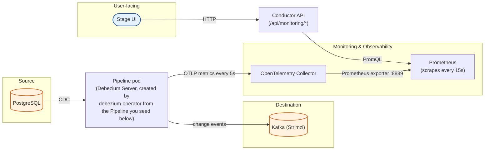
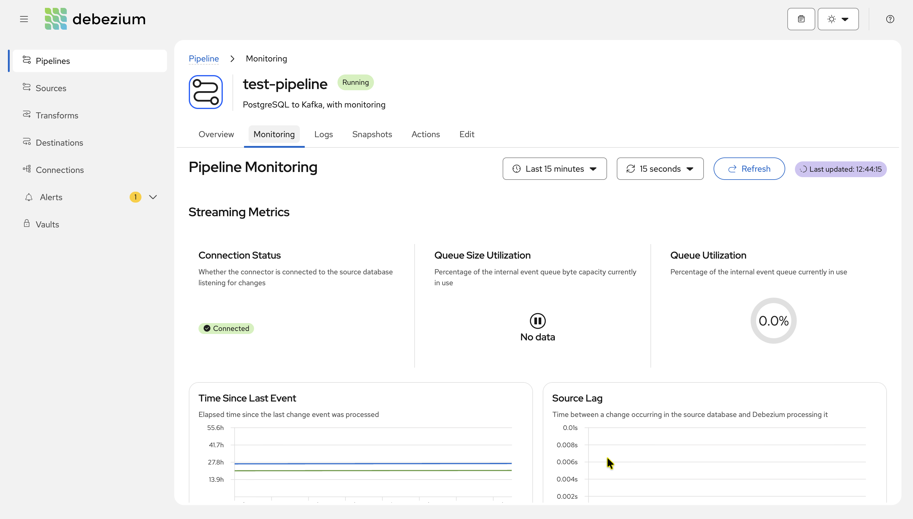
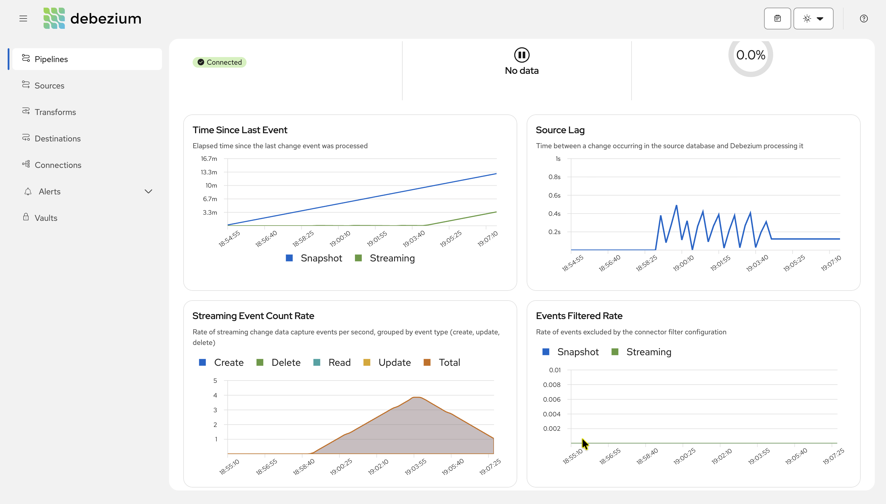
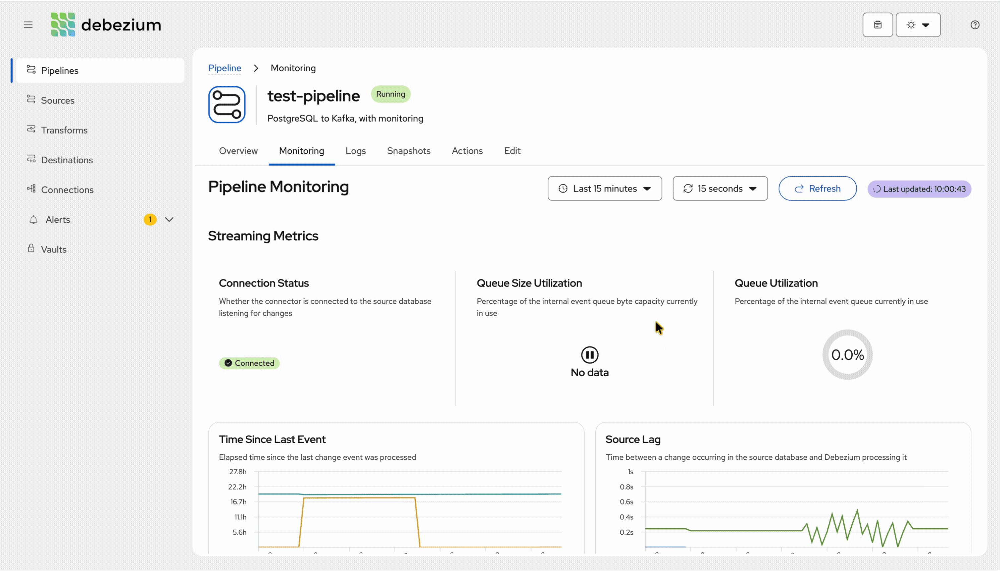
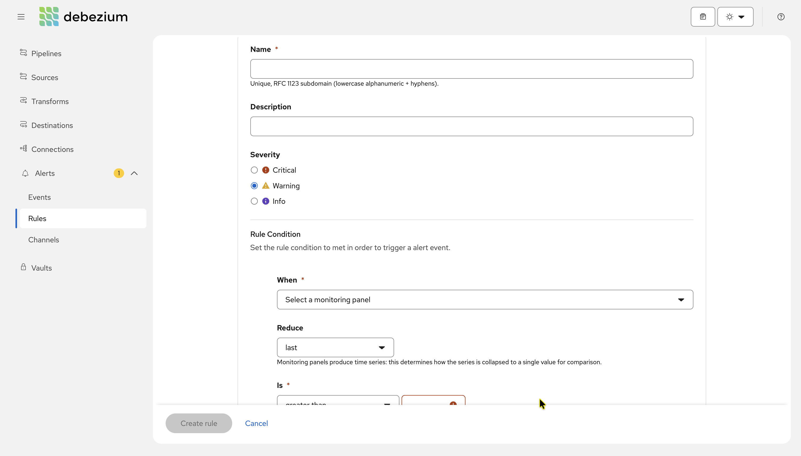
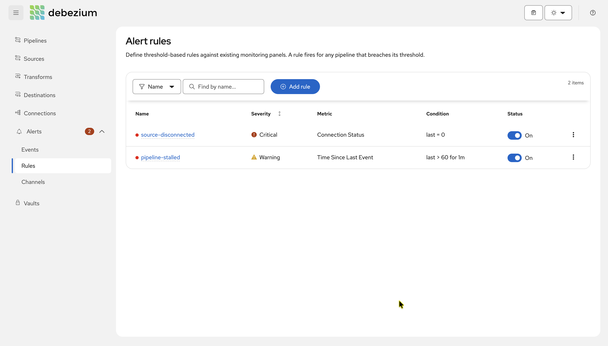
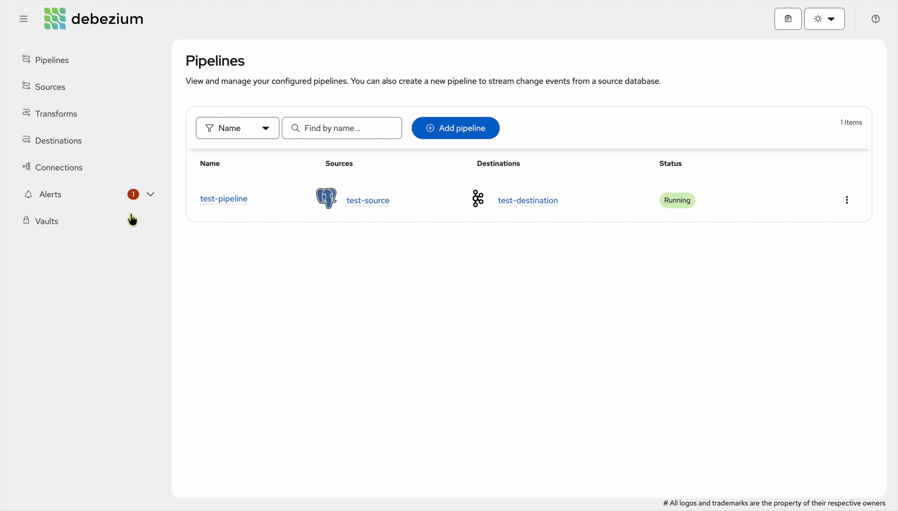

Using Debezium Platform built-in Monitoring and Alert
===

This example walks you through running the Debezium Management Platform with **monitoring enabled and testing alerts in the Platform**.

It builds on [`../postgresql-kafka-example`](../postgresql-kafka-example), which provides a detailed UI walkthrough covering Connections, Sources, Destinations, and Pipelines, explaining each field along the way. If you're new to the Platform, start with that example first.

Here, we reuse the same PostgreSQL-to-Kafka setup and focus on integrating monitoring, exploring the monitoring panels, generating activity to observe metric changes, and configuring and testing alerts. For more details, see the [Pipeline monitoring documentation](https://debezium.io/documentation/reference/operations/debezium-platform.html#_pipeline_monitoring).

Each step is backed by a script that you can run as you follow along. All scripts source [`env.sh`](./env.sh) for shared configuration, including the cluster name, namespaces, chart versions, and hostnames, so you only need to update these values in one place.

How a number gets onto a panel
---



Prepare the environment
---

**Prerequisites**

- [minikube](https://minikube.sigs.k8s.io/docs/)
- `kubectl`, `helm`
- `curl` and [`jq`](https://jqlang.org/) (used by the seed script)

> **_NOTE:_** This example reuses the same minikube profile name (`debezium`) and `/etc/hosts` entry
> (`platform.debezium.io`) as [`../postgresql-kafka-example`](../postgresql-kafka-example). Run `./clean-up.sh`
> in that example first if you still have it running, or edit `CLUSTER` in [`env.sh`](./env.sh) to use a
> different profile.

`create-environment.sh` provisions a local minikube cluster with an ingress controller and points
`platform.debezium.io` at it via `/etc/hosts`. 

```sh
./create-environment.sh
```

> **_NOTE:_** On macOS, keep the printed `sudo minikube tunnel -p debezium` command running in a separate
> terminal for the rest of this example — the ingress isn't reachable from the host without it.

Install the platform with monitoring
---

### 1. Install the monitoring stack

Monitoring depends on two operators, which must exist before the platform is installed:

- the **OpenTelemetry Operator**, which turns the `OpenTelemetryCollector` resource the platform chart creates
  into a running collector pod,
- **kube-prometheus-stack**, which provides the Prometheus Operator (it consumes `ServiceMonitor` resources)
  and the Prometheus server the Conductor queries.

```sh
./setup-monitoring.sh
```

> **_NOTE:_** The script installs `kube-prometheus-stack` under that exact release name.
> Both `monitoring.prometheus.url` and the `ServiceMonitor` label in the next steps are derived from it.

```sh
$ kubectl get pods -n monitoring

NAME                                                     READY   STATUS    RESTARTS   AGE
prometheus-kube-prometheus-stack-prometheus-0            2/2     Running   0          2m10s
kube-prometheus-stack-operator-6c6d4f8d9-abcde           1/1     Running   0          2m40s
kube-prometheus-stack-kube-state-metrics-7f9d8c6-fghij   1/1     Running   0          2m40s
alertmanager-kube-prometheus-stack-alertmanager-0        2/2     Running   0          2m10s
```

### 2. Install the source database and destination Kafka

Same as the base example, PostgreSQL instance pre-seeded with the `inventory` schema as the source and a Strimzi-managed Kafka cluster as the destination.

```sh
./setup-infra.sh
```

### 3. Deploy the Debezium Platform

Here we install the same `debezium-platform` Helm chart, but
[`values.yaml`](./values.yaml) adds a `monitoring` block on top of the usual `domain`/`database`/`ingress`
settings:

```yaml
monitoring:
  otel:
    enabled: true
    collector:
      image: "ghcr.io/open-telemetry/opentelemetry-collector-releases/opentelemetry-collector-contrib:0.152.0"
  prometheus:
    url: "http://kube-prometheus-stack-prometheus.monitoring.svc.cluster.local:9090"
    serviceMonitor:
      labels:
        release: kube-prometheus-stack
```


```sh
./setup-platform.sh
```

```sh
$ kubectl get pods -n debezium-platform

NAME                                                READY   STATUS    RESTARTS   AGE
conductor-7c48c54c5c-rmjw9                          1/1     Running   0          2m
stage-6c64f68df6-cfhjs                              1/1     Running   0          2m
debezium-operator-666f7b44d9-6tf4n                  1/1     Running   0          2m
postgres-69c4c64ff5-2tfmw                           1/1     Running   0          2m
debezium-platform-otel-collector-collector-xxxxx    1/1     Running   0          90s
```

The Stage UI is now reachable at `http://platform.debezium.io/`.

### 4. Create the pipeline

Monitoring needs something to monitor, so the next step is to set up the usual Connection → Source → Destination → Pipeline workflow.

You can configure these through the [Platform UI](http://platform.debezium.io/), following the [base example's detailed walkthrough](../postgresql-kafka-example/README.md#using-the-debezium-platform-stageui-for-setting-up-our-data-pipeline), which explains each field. Alternatively, you can skip ahead by running [`seed-pipeline.sh`](./seed-pipeline.sh), which creates `postgres-connection`, `kafka-connection`, `test-source`, `test-destination`, and `test-pipeline` through the Conductor API.

```sh
./seed-pipeline.sh
```


It prints the direct link to the Monitoring tab, e.g. `http://platform.debezium.io/pipeline/1/monitoring`.

Explore the monitoring
---

### 5. Open the Monitoring tab

Open the link printed in the last step (or **Pipelines** → `test-pipeline` → **Monitoring**) and leave it
open for the rest of this example.



The tab has two sections, matching the `category` of each panel.

#### Streaming — ongoing change data capture

| Panel | What it shows |
| --- | --- |
| **Streaming Event Count Rate** | Change events/sec, split by `create` / `update` / `delete`, plus a `total` line. |
| **Connection Status** | Whether the connector is connected to the source database. |
| **Committed Transactions Rate** | Rate of committed source transactions being processed. |
| **Time Since Last Event** | Seconds since the last change event. |
| **Source Lag** | Time between a change in the source database and Debezium processing it. |
| **Queue Utilization** | % of the internal event queue (by event count) in use. |
| **Queue Size Utilization** | % of the internal event queue's byte capacity in use. |
| **Erroneous Events Rate** | Rate of events that errored during processing. |
| **Events Filtered Rate** | Rate of events excluded by include/exclude list configuration. |

#### Snapshot — the one-time initial copy

| Panel | What it shows |
| --- | --- |
| **Snapshot Status** | Lifecycle state: `running`, `completed`, `aborted` or `skipped`. |
| **Snapshot Table Progress** | Tables captured so far, out of the total in the snapshot. The donut shows percent complete, with the remaining and completed counts beside it. |
| **Snapshot Duration** | Elapsed time of the current or most recent snapshot. |
| **Snapshot Event Count Rate** | Rate of snapshot (initial-load) change events/sec. |

The snapshot ran once, right after the pipeline was created, so these look flat. Scenario C below makes them
move again.


### 6. Make the panels move

Keep the Monitoring tab open while you run them, and give each one 30–45 seconds.


#### A. Watch the event chart climb

A single burst gives one bump that decays; a steady drip gives a chart that climbs and holds:

```sh
./generate-traffic.sh            # defaults: 60 batches x 20 rows, one batch every 5s
./generate-traffic.sh 20 50      # or: batches, rows-per-batch
```



**Watch:** **Streaming Event Count Rate** climbs then plateaus, **Time Since Last Event** stays near 0, and
**Committed Transactions Rate** lifts.

<!-- #### B. Watch a stalled pipeline

Stop `generate-traffic.sh` with `Ctrl+C`, do nothing for two minutes, then insert a single row:

```sh
kubectl exec -n debezium-platform deploy/postgresql -- psql -U debezium -d debezium -c \
  "INSERT INTO inventory.products (name, description, weight) VALUES ('wakeup', 'one row', 1);"
```

**Watch:** **Time Since Last Event** climbs as a diagonal line, then drops straight back to ~0 on the insert. -->

#### B. Make the Snapshot panels light up

The snapshot completed as soon as the pipeline was created, so these panels appear flat. Debezium tracks snapshot progress in an offset table in the Platform's own database. Clearing the offset records and restarting the pipeline forces the snapshot to run from scratch.

```sh
./replay-snapshot.sh
```

**Watch:** switch to the **Snapshot** section straight away. **Snapshot Status** goes `running` → `completed`,
**Snapshot Table Progress** fills toward 100% as the remaining count drops, and **Snapshot Duration** and
**Snapshot Event Count Rate** fill in.

#### C. Flip Connection Status to disconnected

The script repeatedly kills the source database's
replication connection; Debezium reconnects on its own and the pipeline pod never restarts.

```sh
./break-connection.sh
```

**Watch:** **Connection Status** flips to **disconnected** partway through the loop and returns to
**connected** about 30s after it ends. Keep your eyes on it — Debezium reconnects on its own, so the dip
typically lasts only about a minute, and if you look away the panel reads **connected** again as though
nothing ever happened. (That is precisely the gap the [alerting section](#alerting-get-told-instead-of-watching)
below closes.)

After running through the scenarios above and observing the corresponding panels light up, you should see the monitoring tab having panels like shown below.




Alerting: get told instead of watching
---

### 7. Create an alert rule

Open **Alerts** → **Rules** in the left navigation and create a rule. The form reads as a sentence.

| Field | Value | Why |
| --- | --- | --- |
| **Name** | `source-disconnected` | Lowercase letters, digits and hyphens. |
| **Severity** | *Critical* | Critical and Warning count towards the badge on **Alerts** in the left navigation. Info does not. |
| **When** | *Connection Status* | Any panel from the Monitoring tab can be picked here. |
| **Reduce** | *last* | The default, and the right choice for a gauge. |
| **Is** | *equal to* `0` | 1 is connected, 0 is not — no threshold to tune. |
| **For** | *Immediately* | Fire on the first evaluation that sees a 0, with no pending state. |



Save it, and the rule shows up in the list with its condition rendered back as `last == 0`, plus a toggle
that disables it without deleting it.

> **_NOTE:_** Rules are global — one rule covers every pipeline, and each breaching pipeline gets its own
> incident. There is only one pipeline here, but you won't have to revisit the rule when you add more.

Then break the connection, for longer than the default:

```sh
./break-connection.sh 30
```

<!-- The default of 14 kills covers about 70 seconds, which can slip between two evaluations and never be noticed.
30 kills covers roughly two and a half minutes, so at least one evaluation is guaranteed to land inside the
window. -->

**Watch:** the rules list marks `source-disconnected` as firing, the badge on **Alerts** in the left
navigation turns red and counts 1, and a new incident appears under **Alerts** → **Events**. About a minute
after the loop ends Debezium reconnects and the incident resolves on its own.



You can watch the **Connection Status** panel dip for about a minute before returning to connected. If you're not actively monitoring the panel, you might miss it. The alerting rule catches the issue regardless.

### 8. Alert events

**Alerts** → **Events** lists each time the rule fired and resolved. After the step above you should have one closed critical incident.

The badge on **Alerts** in the left navigation counts firing Critical and Warning alerts and takes the colour of the highest severity: red for Critical, amber for Warning.



### Notifying outside the platform

Alerts always appear in the UI, which is why the walkthrough above needed no setup. There are two other channels which can be set under **Alerts** → **Channels** and attach it to a rule through the rule's *Additional channels*
field. One channel can serve several rules, and each has a **Test** button.


- **Email** needs an SMTP server, set at install time through `alerting.email.host`, `alerting.email.from` and
  a secret referenced by `alerting.email.auth.existingSecret`.
- **Webhook** needs a URL that accepts a POST, set on the channel with an HTTP method and optional headers
  (Slack, PagerDuty, Teams).

See the [`debezium-platform` Helm chart README](https://github.com/debezium/debezium-platform/blob/main/helm/README.md#alerting)
for the full set of `alerting.*` values.


Cleanup
---
```sh
./clean-up.sh
```

This deletes the `debezium` minikube profile, and everything deployed in it goes with it.
