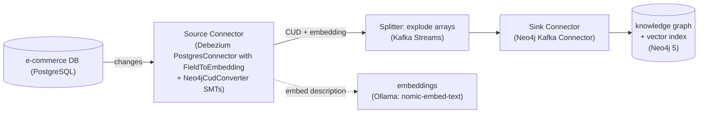
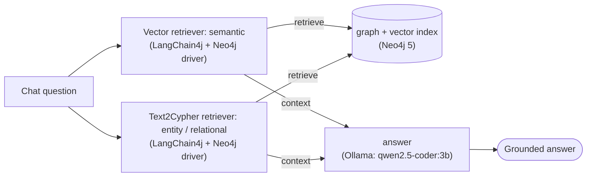

# Graph-RAG with Debezium (Postgres → Neo4j knowledge graph → LLM)

This example shows how **Debezium keeps the Neo4j knowledge graph an LLM retrieves from in sync with
an operational database**.  
In this example a relational PostgreSQL e-commerce schema is streamed into a **Neo4j
knowledge graph** via Change Data Capture, and a small assistant answers questions grounded in that
graph.  
Change a row in Postgres and the assistant's answer changes seconds later without any re-indexing and
restart.

Each question is answered using two levels of retrieval, and the results are combined.

1. **Vector search** for fuzzy questions (*"something for the garden"*): matches the question against
   product embeddings, then follows the graph to the related orders and customers.
2. **Text2Cypher** for precise questions (*"what did a specific customer buy?"*): the chat model
   writes a Cypher query and runs it.

Neo4j 5 stores the graph and the vector index together (no separate vector database).  
The graph is populated **deterministically from the relational schema** using the `Neo4jCudConverter`
SMT, so it is always consistent with Postgres, and the embeddings are also generated **during CDC**
by the debezium-ai `FieldToEmbedding` SMT.
The client is a Quarkus app using [LangChain4j](https://docs.langchain4j.dev/) (via
`quarkus-langchain4j-ollama`) for retrieval and the LLM, and the
[Neo4j Java driver](https://neo4j.com/docs/java-manual/current/) for vector search and Cypher.


## Contents

* [Architecture](#architecture)
* [The knowledge graph](#the-knowledge-graph)
* [Prerequisites](#prerequisites)
* [1. Start the pipeline](#1-start-the-pipeline)
* [2. Register the connectors](#2-register-the-connectors)
* [3. Create the vector index](#3-create-the-vector-index)
* [4. Ask the assistant](#4-ask-the-assistant)
* [5. See the context stay live](#5-see-the-context-stay-live)
* [How it works](#how-it-works)
* [Cleanup](#cleanup)
* [References](#references)

## Architecture

### Ingest: Debezium keeps the graph in sync with Postgres and generates embeddings



### Query: Graph-RAG assistant




## The knowledge graph

The graph is derived deterministically from the relational schema: foreign keys and the join
table become relationships. **No LLM builds the graph; the LLM only reads it.**

```
(:Customer)                                    <- customers table
(:Product {description, embedding})            <- products table
(:Order)-[:PLACED_BY]->(:Customer)             <- orders table (customer_id FK)
(:Order)-[:CONTAINS {quantity}]->(:Product)    <- order_items join table
```

`products` carries a `description` so vector search has meaningful text to embed; the `embedding`
property is computed from it during CDC by the `FieldToEmbedding` SMT and written to the node by the
Neo4j sink.

## Prerequisites

* Docker and Docker Compose
* A JDK 21 and Apache Maven to build/run the client
* Ports free on localhost: `8083` (Connect), `7474`/`7687` (Neo4j), `5432` (Postgres),
  `9092` (Kafka), `11434` (Ollama)
* **Memory:** Ollama runs on CPU inside the Docker VM, so this
  example uses small models. Give the VM at least ~8 GiB; if you switch to a larger chat model, raise it.

All commands below run from this directory and inherit `DEBEZIUM_VERSION` from the repository's
root [`.env`](../.env).

## 1. Start the pipeline

```shell
docker-compose --env-file ../.env up --build
```

The `docker-compose --build` compiles the splitter and builds the Connect image, which bundles the Neo4j sink
connector **and** the Debezium AI embeddings (Ollama) module, so the first build downloads some
extra dependencies.

Pull the Ollama models (first run only, they are cached in `./ollama`). Do this **before**
registering the connectors: the `FieldToEmbedding` SMT calls the embedding model during the initial
snapshot, so `nomic-embed-text` must already be available. `qwen2.5-coder:3b` is the chat model; it
is code-tuned (good at writing Cypher) and small enough to stay responsive on CPU.

```shell
docker-compose --env-file ../.env exec ollama \
  sh -c "ollama pull qwen2.5-coder:3b && ollama pull nomic-embed-text"
```

## 2. Register the connectors

In a second terminal:

```shell
curl -i -X POST -H "Accept:application/json" -H "Content-Type:application/json" \
  http://localhost:8083/connectors/ -d @register-postgres-source.json
curl -i -X POST -H "Accept:application/json" -H "Content-Type:application/json" \
  http://localhost:8083/connectors/ -d @register-neo4j-sink.json
```

Within a few seconds the graph is populated, with each `Product` already carrying its CDC-generated
`embedding`. Check it in the Neo4j Browser at <http://localhost:7474> (user `neo4j`, password
`password`):

```cypher
MATCH (o:Order)-[r:CONTAINS]->(p:Product) RETURN o, r, p;
MATCH (p:Product {id:200}) RETURN size(p.embedding);   // 768
```

## 3. Create the vector index

The embeddings are already on the nodes (written by the `FieldToEmbedding` SMT during CDC). The only
thing left is to create a
[Neo4j vector index](https://neo4j.com/docs/cypher-manual/current/indexes/semantic-indexes/vector-indexes/).

```shell
cd client
mvn -q -B -DskipTests clean package
java -jar target/quarkus-app/quarkus-run.jar create-index
```

Confirm the graph and vector layer:

```shell
java -jar target/quarkus-app/quarkus-run.jar list-graph
# Graph contents: 4 Customer(s), 3 Product(s) (3 embedded), 2 Order(s)
```

## 4. Ask the assistant

The assistant answers both semantic and entity questions because the router sends each question to
both retrievers:

```shell
# Semantic (vector path)
java -jar target/quarkus-app/quarkus-run.jar query-chat \
  "What do you have for the garden and who has bought it?"

# Entity / relational (Text2Cypher path)
java -jar target/quarkus-app/quarkus-run.jar query-chat "What did Sally buy?"
```


### Interactive chat

`query-chat` boots the app, answers once, and exits. For a live session that stays running, use
`chat`; it keeps the Neo4j and Ollama connections warm and answers each line you type:

```shell
java -jar target/quarkus-app/quarkus-run.jar chat
```

```
Graph-RAG chat. Ask about products, orders and customers. Type 'exit' to quit.

You: What did Sally buy?
Assistant: Sally Thomas bought 2 Widgets (order #5001), a stainless-steel garden trowel.

You: what can I buy for DIY jobs?
Assistant: The Gizmo is a compact cordless power drill, good for home DIY and repairs.

You: exit
Bye.
```

The interactive session keeps conversation history, but **retrieval runs on each message's text
alone**,.

By default the chat prints only the conversation. To see the retrieval internals (vector scores, the
generated Cypher, and the exact context handed to the LLM), run any command with DEBUG logging for
the app's package:

```shell
java -Dquarkus.log.category.\"io.debezium.examples.graphrag\".level=DEBUG \
  -jar target/quarkus-app/quarkus-run.jar chat
```

## 5. See the context stay live

Change the data in Postgres and re-ask, and the answer follows the database:

```shell
docker-compose --env-file ../.env exec postgres \
  psql -U postgres -d postgres -c "UPDATE orders SET status = 'shipped' WHERE id = 5001;"
```

```shell
cd client
java -jar target/quarkus-app/quarkus-run.jar query-chat \
  "What is the status of the order containing the garden trowel?"
# now reports 'shipped', the graph context was refreshed by CDC, no re-index needed
```

Because embeddings are maintained by CDC too, even the *semantic* layer stays current. Edit a
product's `description` and the `FieldToEmbedding` SMT re-embeds it automatically, with no manual
re-indexing:

```shell
docker-compose --env-file ../.env exec postgres \
  psql -U postgres -d postgres -c \
  "UPDATE products SET description = 'A heavy-duty snow shovel for clearing driveways in winter.' WHERE id = 200;"
```

Inserting or deleting products and orders works the same way: new rows get their embedding during
CDC, and the vector index (already created) picks them up automatically.
## Cleanup

```shell
docker-compose --env-file ../.env down -v
```

## References

* [`Neo4jCudConverter` SMT documentation](https://debezium.io/documentation/reference/stable/transformations/neo4j-cud-converter.html)
* [Debezium AI / `FieldToEmbedding` embeddings SMT](https://debezium.io/documentation/reference/stable/ai/embeddings.html)
* [`debezium-relational-to-neo4j`](../debezium-relational-to-neo4j), the relational → graph ingest pipeline reused here
* [`ai-rag`](../ai-rag): a vector-only RAG variant with Debezium Server and Milvus
* [Neo4j vector indexes](https://neo4j.com/docs/cypher-manual/current/indexes/semantic-indexes/vector-indexes/)
* [Neo4j vector search / Text2Cypher (GraphRAG)](https://neo4j.com/labs/genai-ecosystem/)
```
